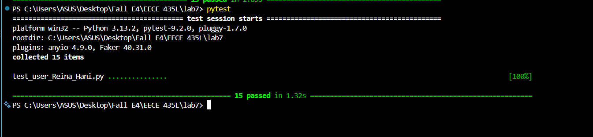

# Lab 7 – Python Testing

**Reina Hani** · EECE 435L Software Tools Lab · Fall 2026–2027

Pytest tests for the Flask user app from Lab 5. The app stores users in SQLite and exposes a small REST API to list, add, update and delete them.

## Project structure

| File | What it is |
|---|---|
| `app.py` | Flask app with the API routes |
| `database.py` | SQLite functions: create the table, insert, get, update and delete users |
| `test_user_Reina_Hani.py` | Pytest tests for the database functions and the API |
| `requirements.txt` | Packages needed to run the app and the tests |

## Setup

```bash
pip install -r requirements.txt
```

## Running the app

```bash
python app.py
```

On the first run this creates `database.db` with three default users, then starts the server at `http://127.0.0.1:5000`.

### API endpoints

| Method | Route | Description |
|---|---|---|
| GET | `/api/users` | Get all users |
| GET | `/api/users/<user_id>` | Get one user |
| POST | `/api/users/add` | Add a user (JSON body) |
| PUT | `/api/users/update` | Update a user (JSON body with `user_id`) |
| DELETE | `/api/users/delete/<user_id>` | Delete a user |

## Running the tests

```bash
pytest -v
```

Every test runs on its own temporary database, so your real `database.db` is never changed.

### What is tested

| # | Function | Tests |
|---|---|---|
| 1 | Database created with the default users on first run | `test_database_created_with_specified_users`, `test_database_not_seeded_twice` |
| 2 | `insert_user()` | `test_insert_user`, `test_insert_user_missing_field_returns_empty` |
| 3 | `get_users()` | `test_get_users` |
| 4 | `get_user_by_id()` | `test_get_user_by_id`, `test_get_user_by_id_not_found` |
| 5 | `update_user()` | `test_update_user` |
| 6 | `delete_user()` | `test_delete_user` |
| 7 | `api_get_user()` | `test_api_get_users`, `test_api_get_user`, `test_api_get_user_not_found` |
| 8 | `api_add_user()` | `test_api_add_user` |
| 9 | `api_update_user()` | `test_api_update_user` |
| 10 | `api_delete_user()` | `test_api_delete_user` |

The API tests check both the response status code and the data sent or returned.

## Result

All 15 tests pass.


